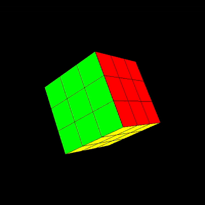

# SoftwareRendering

C++와 Win32 API로 3D 렌더링 과정을 CPU에서 한 단계씩 직접 구현한 학습 프로젝트입니다.
창 띄우기부터 시작해 점·선·면을 거쳐, 원근 투영과 백페이스 컬링으로 그린 루빅스 큐브를 키보드로 돌리고 층을 회전시키는 데까지 진행했습니다.



▶ 실행 영상: https://youtu.be/vkt34C9ZZeo

| 항목 | 내용 |
|---|---|
| 언어 | C++ |
| 라이브러리 | Eigen 5 (선형대수), Win32 API, GDI+ |
| 개발 환경 | Visual Studio (플랫폼 도구 집합 v143), Windows |
| 기간 | 2026.10 ~ 2026.11 |

## 구현 범위

| 직접 구현 | 라이브러리에 맡긴 부분 |
|---|---|
| 뷰 행렬(LookAt) | 삼각형 내부 채우기 (GDI+ `FillPolygon`) |
| 원근 투영 행렬 | 선 그리기 (GDI+ `DrawLine`) |
| 뷰포트 변환 | 행렬·벡터 연산 (Eigen) |
| 뷰 공간 백페이스 컬링 | |
| 정점·인덱스 버퍼 기반 그리기 | |
| 메모리 DC를 이용한 더블 버퍼링 | |
| 루빅스 큐브 칸 색 상태와 층 회전 로직 | |

## 렌더링 흐름

```
정점 버퍼 (동차 좌표, w = 1)
  → 월드 변환 (키 입력으로 X·Y축 회전)
  → 뷰 변환 (LookAt)          ── 이 단계의 좌표로 백페이스 컬링 판정
  → 원근 투영 → w로 나누기 (NDC)
  → 뷰포트 변환 (화면 좌표, y축 뒤집기)
  → 앞면 삼각형만 칸 색으로 채우기 + 칸 경계선
  → 메모리 DC에 그린 뒤 화면 DC로 복사 (더블 버퍼링)
```

## 프로젝트 구성

솔루션 하나에 마일스톤 단계별 프로젝트가 들어 있습니다.

| 프로젝트 | 마일스톤 | 화면에서 확인되는 상태 |
|---|---|---|
| `HelloWindows` | M1 | Win32 창이 열리고, 닫으면 프로그램이 정상 종료된다 |
| `BasicRendering` | M2 · M3 | 클릭한 지점에 점과 선으로 표시가 그려진다 |
| `RenderSquare` | M4 · M5 | 정점·인덱스 버퍼로 만든 사각형이 채워지고, 이동·회전·크기 조절이 반영된다 |
| `RubiksCube` | M6 ~ M9 | 원근감 있는 큐브가 면별 색으로 채워지고, 키 입력으로 회전하며 한 층을 돌릴 수 있다 |

`RubiksCube`의 주요 파일:
- `CubeMain.cpp`: 창, 메시지 처리, 렌더링 루틴
- `Transition.h`: LookAt, 원근 투영, 뷰포트 변환
- `CubeLogic.h`: 칸 색 상태와 U·D·F·B·L·R 회전
- `RubiksCubeMesh.h`: 정점·인덱스·라인 인덱스 버퍼

## 조작법 (RubiksCube)

| 키 | 동작 |
|---|---|
| ← → | Y축 회전 |
| ↑ ↓ | X축 회전 |
| Enter | 회전 초기화 |
| U · D · F · B · L · R | 해당 면을 시계방향으로 90도 회전 (그 면을 정면으로 바라본 기준) |

## 주요 결정

진행하며 내린 결정은 마일스톤 리포트와 노션 결정 기록에 배경·선택지·이유와 함께 남겼습니다.

- **좌표계**: 오른손 좌표계, y축 위, 카메라는 −z를 바라본다. 화면의 y축 뒤집기는 뷰포트 변환에서 처리한다.
- **벡터 규약**: Eigen의 열 벡터 규약을 따른다. 행 벡터 규약인 레퍼런스의 수식은 전치해서 가져왔다.
- **NDC 깊이 범위**: 참고 교재의 수식을 그대로 쓸 수 있도록 OpenGL 계열처럼 −1~1로 정했다.
- **변환 행렬 합성**: 정점 버퍼에 미리 w = 1을 붙이고, proj · view · world는 프레임마다 한 번만 합쳐 모든 정점에 재사용한다.
- **백페이스 컬링 판정 공간**: 교재에서 후면 제거를 시점 공간에서 절단 공간으로 넘어가는 시점에 수행하는 흐름을 따라 뷰 공간에서 판정한다.
- **백페이스 컬링 판정 방식**: 법선과 카메라→면 벡터(v0)를 내적해 판정한다. 고정된 시선 방향(0, 0, −1)으로 판정하는 방식은 직교 투영에서만 맞기 때문이다.
- **GDI → GDI+ 전환**: GDI가 실수 좌표를 지원하지 않아 M4에서 GDI+로 바꿨다.
- **큐브 상태 저장**: 칸 54개의 색을 면마다 3×3 `char` 배열로 두고, 인덱스 버퍼는 "이 삼각형이 몇 번 칸인지"를 찾는 데만 쓴다. 회전 로직을 렌더링과 분리하기 위해서다.

## 알려진 한계

- 층 회전은 색 배열만 바꾸는 방식이며, 회전 애니메이션은 없다.
- 가운데 층 회전과 반시계 회전은 구현하지 않았다. 반시계 회전은 같은 회전을 3번 하는 것으로 대신한다.
- w가 0 이하인 점(카메라 뒤나 카메라 위치)은 따로 처리하지 않는다.
- 조각 27개가 서로 겹치는 상황에서도 백페이스 컬링만으로 충분한지는 확인하지 않았다.

## 빌드

1. Eigen 5를 내려받아 `C:\Eigen5`에 둔다. 다른 위치라면 `RenderSquare`, `RubiksCube` 프로젝트 속성의 C/C++ → 추가 포함 디렉터리를 바꾼다.
2. `SoftwareRendering.sln`을 Visual Studio로 열고, 실행할 프로젝트를 시작 프로젝트로 지정한 뒤 빌드한다.

## 진행 방식과 AI 활용 범위

- 마일스톤을 "화면에서 확인 가능한 상태"로 정의하고 하나씩 완료했다.
- 마일스톤마다 공부한 내용을 리포트로 정리했다: [`_Documents`](./_Documents)
- 구현 코드는 직접 작성했다. M2·M3는 Microsoft Learn의 드로잉 마커 예제를 바탕으로 했다. gdi-3d는 M4부터 참고했고, M6 이후는 gdi-3d의 프로젝트 구조를 바탕으로 했다.
- Claude는 개념 설명, 진행 순서 추천, 디버깅 원인 설명, 리포트 초안 작성에 사용했다.
- 다음 데이터는 요청해서 Claude가 생성했다.
  - M6 정육면체의 정점 8개와 삼각형 12개의 인덱스
  - 루빅스 큐브의 정점·인덱스·라인 인덱스 버퍼 데이터(`RubiksCubeMesh.h`)
- `CLAUDE.md`는 Claude와 작업할 때의 규칙(정답 코드를 먼저 주지 않기 등)을 정리한 문서다.

## 레퍼런스

- [gdi-3d](https://github.com/george7378/gdi-3d): 프로젝트 구조 참고
- 「이득우의 게임 수학」 10~12장 (3차원 공간, 외적, 원근 투영)
- 「OpenGL로 배우는 3차원 컴퓨터 그래픽스」(2013 개정판) 6~8장 (모델 변환과 시점 변환, 투상 변환과 뷰 포트 변환, 가시성 판단)
- [Learn to Program for Windows (Microsoft Learn)](https://learn.microsoft.com/ko-kr/windows/win32/learnwin32/learn-to-program-for-windows)
- [Eigen 문서](https://libeigen.gitlab.io/eigen/docs-5.0/)
